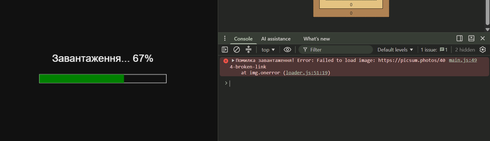
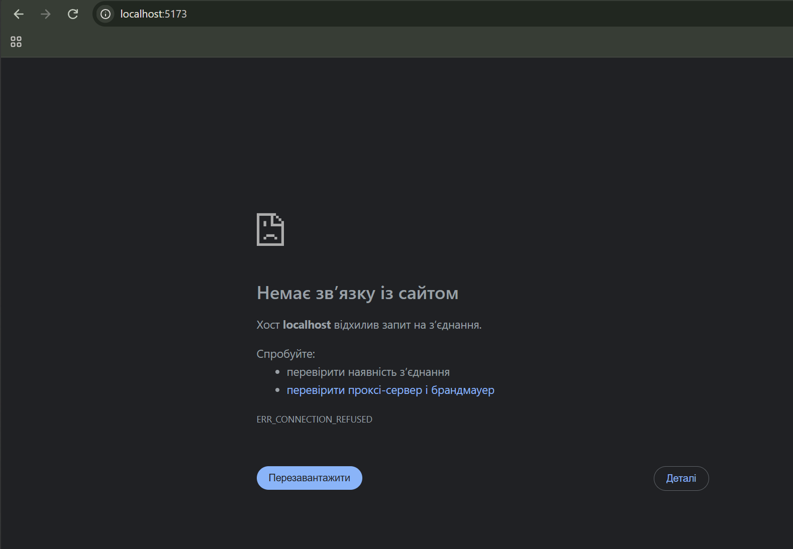
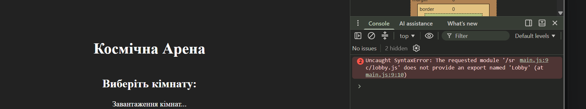

# Lab 3: Асинхронний JavaScript

## Що було реалізовано

1. **M1 (Пайплайн ассетів):** Написано завантажувач ресурсів (`fetchJson`, `loadImage`, `loadAudio`). Реалізовано паттерн відкладених повторних спроб (exponential backoff + jitter) для стійкості до мережевих збоїв, крім помилок 4xx. Завантаження відбувається паралельно через `Promise.all` з відображенням реального прогрес-бару на `canvas`.
2. **M2 (Спрайти та Звук):** Геометричні фігури замінено на спрайти. Інтегровано `Web Audio API`. Для дотримання слабкого зв'язування (Decoupling) ігровий цикл не імпортує аудіо-модуль — комунікація відбувається через шину `EventTarget` (подія `fired`). Аудіоконтекст розблоковується лише після кліку гравця.
3. **M3 (HTTP Лобі):** Додано екран вибору кімнат перед стартом гри. Дані підтягуються через `fetch` із заданим таймаутом (`AbortSignal.timeout`). Лобі періодично оновлюється (`setInterval`), а при переході до гри всі "завислі" запити миттєво скасовуються через `AbortController`.

## Аналіз завантаження: Sequential vs Concurrent

Під час розробки екрана завантаження було проаналізовано різницю між послідовним та паралельним очікуванням промісів:
- **Sequential (Послідовне):** `await loadA(); await loadB();` — кожен наступний файл починає завантажуватися лише після завершення попереднього. Час завантаження дорівнює сумі часу всіх файлів ($t_1 + t_2 + ... + t_n$).
- **Concurrent (Паралельне):** `await Promise.all([loadA(), loadB()])` — всі запити ініціюються одночасно. Загальний час завантаження дорівнює часу завантаження найповільнішого файлу ($max(t_1, t_2, ..., t_n)$). Саме цей підхід використано у проєкті.
## Головоломки Event Loop та Microtasks (Microtask Ordering)

```javascript
Головоломка 1: Базовий Promise vs setTimeout

setTimeout(() => console.log(1), 0);
Promise.resolve().then(() => console.log(2));
console.log(3);

Вивід: 3, 2, 1
Пояснення: Спочатку виконується синхронний код (3). Потім мікрозадача від Promise, де синхронно логується (2), і лише після цього планується нова макрозадача setTimeout, яка виведе (1).

Головоломка 2: await non-promise
async function foo() {
  console.log(1);
  await null;
  console.log(2);
}
foo();
console.log(3);

Вивід: 1, 3, 2
Пояснення: foo() починає виконуватися синхронно до ключового слова await (1). await призупиняє функцію, повертаючи управління Event Loop. Виконується (3), після чого мікрозадача відновлює виконання foo (2).

Головоломка 3: setTimeout всередині .then
Promise.resolve().then(() => {
  setTimeout(() => console.log(1), 0);
  console.log(2);
});
console.log(3);

Вивід: 3, 2, 1
Пояснення: Спочатку виконується синхронний код (3). Потім мікрозадача від Promise, де синхронно логується (2), і лише після цього планується нова макрозадача setTimeout, яка виведе (1).

Головоломка 4: requestAnimationFrame та мікрозадачі
requestAnimationFrame(() => console.log(1));
Promise.resolve().then(() => console.log(2));
console.log(3);

Вивід: 3, 2, 1
Пояснення: Синхронний вивід (3). Далі йде черга мікрозадач (2). Колбеки від requestAnimationFrame (1) виконуються безпосередньо перед наступним перемальовуванням кадру (Paint), тому вони йдуть після мікрозадач, але зазвичай до нових макрозадач.

Головоломка 5: Вкладені мікрозадачі
Promise.resolve().then(() => {
  console.log(1);
  Promise.resolve().then(() => console.log(2));
});
console.log(3);

Вивід: 3, 1, 2
Пояснення: (3) виконується в головному потоці. Перша мікрозадача виводить (1) і одразу додає нову мікрозадачу в ту саму чергу. Event Loop не переходить до макрозадач або рендеру, поки черга мікрозадач не стане повністю порожньою, тому одразу виводиться (2).
```
## Галерея збоїв (Failure Gallery)

У процесі тестування було зімітовано та успішно оброблено типові помилки (гра не крашиться, прогрес безпечно зупиняється або продовжує роботу залежно від логіки):

**1. Зупинка завантаження при помилці 404 (бите посилання на спрайт):**


**2. Втрата з'єднання з локальним сервером (ERR_CONNECTION_REFUSED):**


**3. Помилка імпорту модуля при порушенні синтаксису (Lobby export error):**
